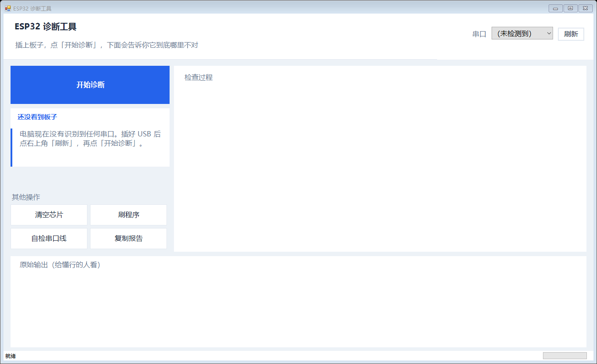

# ESP32 诊断工具

刷 ESP32 失败的时候，Arduino IDE 只会给你一句话：`Failed to connect to Espressif device: No serial data received`。除了"没连上"，它什么都没说。

可没连上的原因有好几种，处理方式完全不一样：

- 芯片根本没进刷机模式，BOOT 键或者那根线断了
- 进了刷机模式，但电脑发过去的数据它收不到
- 供电不够，芯片反复重启
- USB 转串口那颗芯片坏了

靠换线换板一个个试太费时间。这个工具的办法是去读芯片自己的启动日志。



## 判断依据

ESP32 每次复位都会往串口吐一行，长这样：

```
rst:0x1 (POWERON_RESET),boot:0x13 (SPI_FAST_FLASH_BOOT)
```

`boot` 后面那个数就是复位瞬间 IO0 的电平，也就是芯片有没有准备进刷机模式。`rst` 是这次复位的原因，上电、软件重启、看门狗、掉电，值都不一样。

工具做三件事：先正常握一次手；再把 DTR/RTS 四种组合挨个拉一遍，每种抓 900 毫秒原始字节；最后解析抓到的内容给结论。

为什么要试四种组合？因为我不知道你的板子复位线是怎么接的，四种里总有一种对得上。

## 结论对照

| 抓到什么 | 说明 | 怎么办 |
|---|---|---|
| 握手成功 | 一切正常 | 直接刷 |
| `boot:0x03` 或含 `waiting for download` | 芯片在等电脑发数据 | 芯片愿意收，电脑发不进去，接收线坏了 |
| `boot:0x13` | 每次都正常启动 | IO0 没被拉低，BOOT 键或线断了 |
| `rst:0x13` | 掉电复位 | 供电不够，换个 USB 口 |
| 有 `Guru Meditation` | 崩溃回溯 | 固件的问题，跟刷写无关 |
| 一个字节都没有 | 芯片没说话 | 没运行，或者发送脚断了 |

## 用法

双击 `ESP32诊断工具.exe`，或者：

```powershell
powershell -NoProfile -ExecutionPolicy Bypass -File .\ESP32Diag.ps1
```

需要一个 `esptool.exe`。装过 Arduino IDE 的 ESP32 支持包，工具会自己去 `%LOCALAPPDATA%\Arduino15\packages\esp32\tools\esptool_py` 里翻。找不到就丢一个到程序同目录。

## 自己打包

```powershell
.\build.ps1
```

内部用 ps2exe。

## 自测

改完代码可以跑这两个：

```powershell
powershell -File .\ESP32Diag.ps1 --parsetest   # 解析器回归，5 组样本
powershell -File .\ESP32Diag.ps1 --uitest      # 把界面渲染成图片
```

`--uitest` 会把窗口画到 `%TEMP%\esp32diag_render.png`。这是我给自己查布局用的。RichTextBox 在 DrawToBitmap 里不渲染，所以文本内容另外用 TextLength 校验。

## 不管用的地方

- 只在 Windows 加 PowerShell 5.1 上试过
- 四种 DTR/RTS 组合是针对经典 ESP32（WROOM/WROVER）的自动下载电路写的。S3 和 C3 的 strapping 不一样，那几行结论不一定适用
- 烧录固定写 0x10000，只管 Arduino 的应用固件，不是完整的 bootloader 加分区表方案
- exe 没签名，可能被杀软误报。介意就直接跑 ps1

## 许可

没写。要用自己判断。
